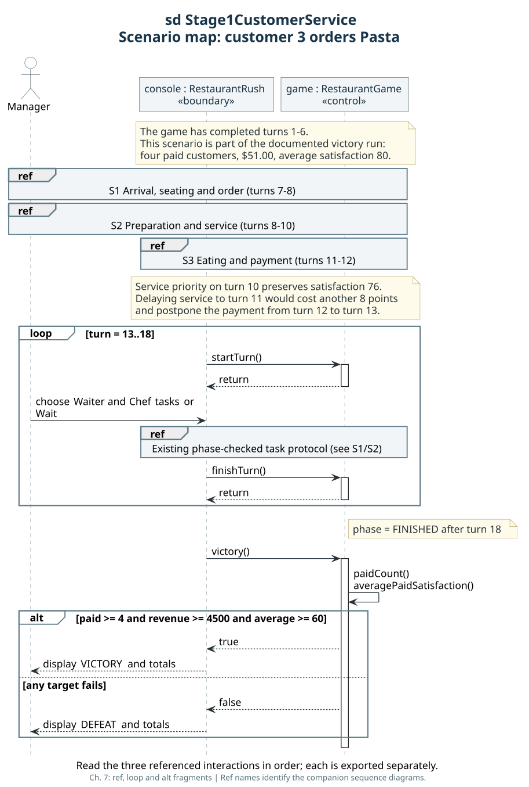

# Stage 1 sequence diagrams — PlantUML

These sequences describe the currently implemented Stage 1, not the proposed constructor-based menu signatures. They are retained as behavioural evidence for the existing report.

This is one scenario decomposed using Chapter 7's `ref` interaction-use notation. Start with the scenario map, then follow S1, S2 and S3. The final result check is on the map.

| Interaction | SVG | Editable PlantUML |
| --- | --- | --- |
| Scenario map and final result | [Open](overview.svg) | [Source](overview.puml) |
| S1 — Arrival, seating and order | [Open](01-order.svg) | [Source](01-order.puml) |
| S2 — Preparation and service | [Open](02-service.svg) | [Source](02-service.puml) |
| S3 — Eating and payment | [Open](03-payment.svg) | [Source](03-payment.puml) |

## Scenario and timing

The game has already executed turns 1-6. Customer 3 arrives on turn 7 and deterministically chooses Pasta when ordering. This follows the reproducible victory plan in `stage_1.md`.

| Turn | Customer 3's relevant interaction | State after turn | Satisfaction |
| --- | --- | --- | --- |
| 7 | Arrive; Waiter seats at table 1 | SEATED | 92 |
| 8 | Waiter takes order; Chef prepares unit 1 | PREPARING | 84 |
| 9 | Waiter waits; Chef prepares unit 2 | READY | 76 |
| 10 | Manager prioritises service; Waiter serves | EATING | 76 |
| 11 | One full eating turn completes | READY_TO_PAY | 76 |
| 12 | Cashier collects 1800 cents and releases table | PAID | 76 |

If the manager waits until turn 11 to serve, satisfaction falls to 68 at the end of turn 10 and the payment shifts to turn 13. This is a concrete effect of the manager's priority decision; it is not a claim that this one delay alone necessarily changes Victory into Defeat.

## Course notation and abstraction

- Lifelines are named `object: Class`; stereotypes identify boundary/control/entity roles (Chapter 7 pp. 5, 20; Chapter 6 pp. 42-45).
- Calls use solid arrows, replies use dashed arrows, and method execution uses activation bars (Chapter 7 pp. 5-6, 21, 23).
- Customer and Order lifelines begin at their dashed open-arrow creation messages (p. 7).
- `loop`, `opt` and `alt` fragments have guards; `ref` frames identify named interactions (pp. 10-13, 21-22).
- The final `alt` covers the result logic's two possible outcomes. The documented scenario follows the Victory branch.

Display-only queries and interactions with other customers are abbreviated. References for staff reset and unrelated end-of-turn checks summarise the named operations, not invented calls. Assignment, counter updates and guards shown on self messages explain the relevant implementation steps. Read S1-S3 as parts of the same scenario, not independently executable turn sequences.

The Cashier's selection scan considers all customers; S3 draws the eligibility call to customer 3 and explicitly omits the other candidates. Payment is eligible only on a later turn than READY_TO_PAY. Revenue increases after the Cashier returns the collected amount, matching the implementation.

No object-destruction cross is drawn on payment: the customer and order stay in the game's history. The table association is released. There are no Stage 2/3 features in these diagrams.

See [the diagram index](../README.md) for the course sources and local rendering instructions.
