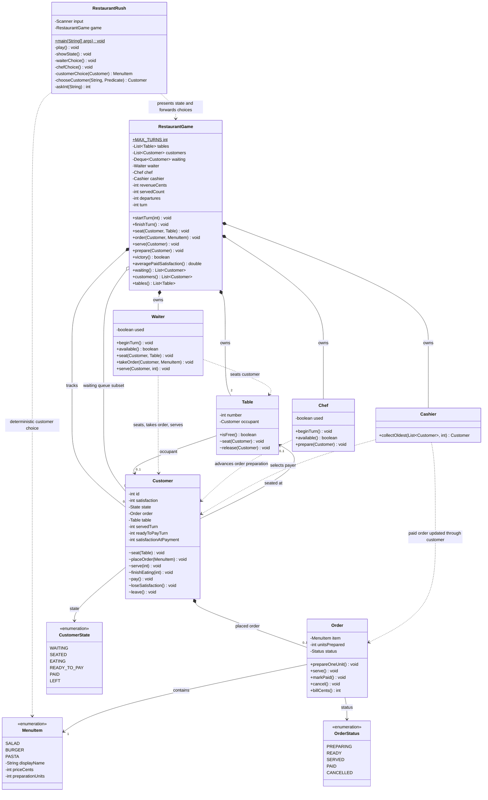

# Restaurant Rush Stage 1 - UML class diagram

This diagram reflects the current Stage 1 Java source. Visibility markers use UML notation: `+` public, `-` private, `#` protected.

## Design notes

- **Encapsulation:** domain state is private; game operations update it through methods.
- **Composition:** `RestaurantGame` owns its staff and tables; each `Customer` owns at most one `Order`.
- **Responsibility split:** `RestaurantRush` handles console input/output, `RestaurantGame` advances the rules, staff classes enforce work limits, and `Customer`, `Order`, and `Table` own their state transitions.
- Stage 1 has only regular customers, so the diagram contains no customer subclasses or polymorphic customer behavior.
