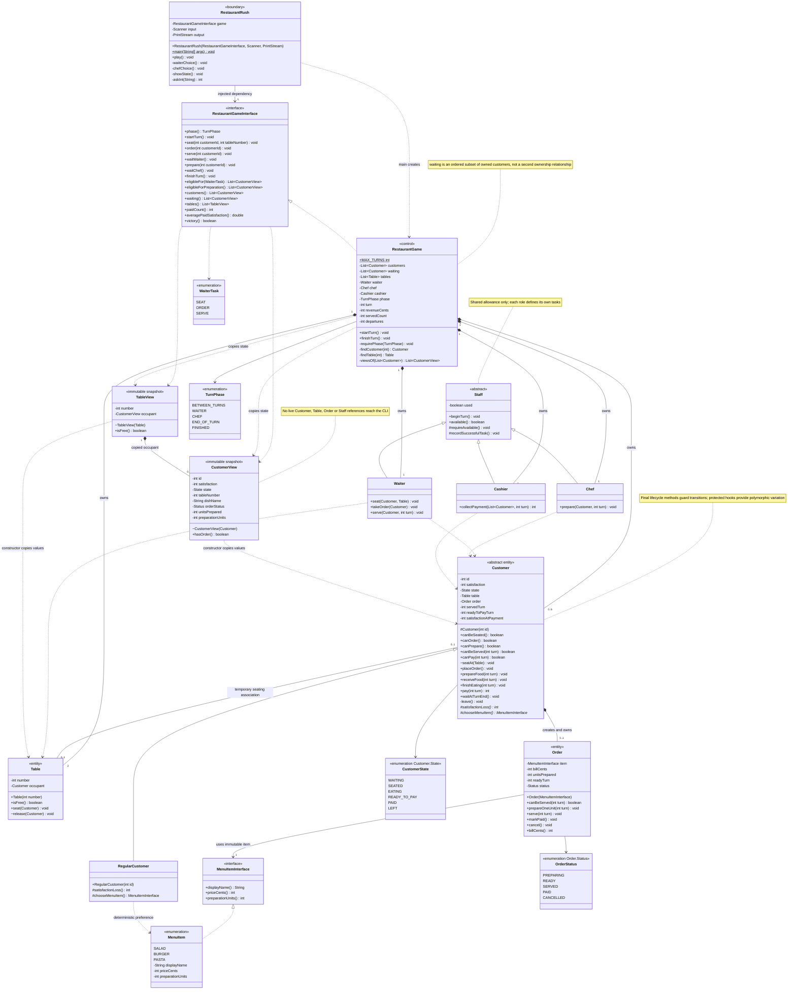

# Stage 1 class diagram

[Open SVG export](stage1-class-diagram.svg)

The source packages are `restaurant` (CLI), `restaurant.game` (control and views) and `restaurant.model` (entities and staff). Key operations are shown; simple accessors are omitted for readability. `+` public, `-` private, `#` protected, `~` package access, `*` abstract operation, `$` static member.

The interface-based CLI and item dependencies are meaningful DIP boundaries. Internal concrete staff ownership is intentional. The abstract customer hierarchy is an OCP extension point; Stage 1 contains only RegularCustomer and makes no claim to implement later customer features. See the rebuild guide for contract details and trade-offs.
