# Stage 1 sequence diagram

[Open SVG export](stage1-sequence-diagram.svg)

This scenario follows customer #3 (Pasta). Turns 1-6 have already executed normally. Manager priority on turn 10 gets the dish served with satisfaction 76; waiting until turn 11 would lose another 8 satisfaction and delay payment. Queries used only for display are abbreviated; state-changing calls and payment ordering follow the Java source.

```mermaid
sequenceDiagram
    actor Manager
    participant CLI as console:RestaurantRush
    participant Game as game:RestaurantGame
    participant Waiter as waiter:Waiter
    participant Chef as chef:Chef
    participant Cashier as cashier:Cashier
    participant Table as table1:Table

    Note over CLI,Game: Turns 1-6 completed, startTurn owns the turn number
    CLI->>+Game: startTurn()
    create participant Customer as customer3:RegularCustomer
    Game->>Customer: new RegularCustomer(3)
    Note over Game,Customer: Turn 7, add to customers and waiting, satisfaction 100
    Game-->>-CLI: phase WAITER
    CLI->>Game: eligibleFor(SEAT)
    Game-->>CLI: immutable customer views
    Manager->>CLI: Seat queue position 1 at table 1
    CLI->>+Game: seat(3, 1)
    Game->>+Waiter: seat(customer3, table1)
    Waiter->>+Table: seat(customer3)
    Table->>Customer: seatAt(table1)
    Table-->>-Waiter: seating completed
    Waiter->>Waiter: recordSuccessfulTask()
    Waiter-->>-Game: completed
    Game->>Game: remove from waiting, phase CHEF
    Game-->>-CLI: completed
    Manager->>CLI: Chef waits
    CLI->>Game: waitChef()
    CLI->>Game: finishTurn()
    Game->>Customer: finishEating(7) [not eating: no change]
    Game->>Cashier: collectPayment(customers, 7)
    Cashier-->>Game: 0
    Game->>Customer: waitAtTurnEnd()
    Customer->>Customer: satisfactionLoss() returns 8
    Note right of Customer: SEATED, satisfaction 92

    Note over CLI,Game: Turn 8: order and prepare unit 1
    CLI->>Game: startTurn()
    Manager->>CLI: Take customer 3's order
    CLI->>Game: order(3)
    Game->>Waiter: takeOrder(customer3)
    Waiter->>Customer: placeOrder()
    Customer->>Customer: chooseMenuItem() returns PASTA
    create participant Order as order3:Order
    Customer->>Order: new Order(PASTA)
    Note right of Order: PREPARING, 0/2 units, bill 1800 cents
    Waiter->>Waiter: recordSuccessfulTask()
    Note right of Game: phase CHEF
    Manager->>CLI: Prepare customer 3's order
    CLI->>Game: prepare(3)
    Game->>Chef: prepare(customer3, 8)
    Chef->>Customer: prepareFood(8)
    Customer->>Order: prepareOneUnit(8)
    Chef->>Chef: recordSuccessfulTask()
    Note right of Order: PREPARING, 1/2 units
    CLI->>Game: finishTurn()
    Game->>Customer: waitAtTurnEnd()
    Note right of Customer: Satisfaction 84

    Note over CLI,Game: Turn 9: Pasta becomes READY
    CLI->>Game: startTurn()
    Manager->>CLI: Waiter waits, Chef prepares customer 3
    CLI->>Game: waitWaiter()
    CLI->>Game: prepare(3)
    Game->>Chef: prepare(customer3, 9)
    Chef->>Customer: prepareFood(9)
    Customer->>Order: prepareOneUnit(9)
    Note right of Order: READY, 2/2 units, readyTurn 9
    Note over Game,Order: Waiter phase has passed, Order also rejects service on readyTurn
    CLI->>Game: finishTurn()
    Game->>Customer: waitAtTurnEnd()
    Note right of Customer: Satisfaction 76

    Note over CLI,Game: Turn 10: manager chooses service priority
    CLI->>Game: startTurn()
    Manager->>CLI: Serve customer 3 instead of another task
    CLI->>Game: serve(3)
    Game->>Waiter: serve(customer3, 10)
    Waiter->>Customer: receiveFood(10)
    Customer->>Order: serve(10) [READY and readyTurn less than 10]
    Note right of Customer: EATING, servedTurn 10
    CLI->>Game: waitChef()
    CLI->>Game: finishTurn()
    Game->>Customer: finishEating(10)
    Note right of Customer: Still EATING, satisfaction remains 76

    Note over CLI,Game: Turn 11: one full eating turn finishes
    CLI->>Game: startTurn()
    CLI->>Game: waitWaiter()
    CLI->>Game: waitChef()
    CLI->>Game: finishTurn()
    Game->>Customer: finishEating(11)
    Note right of Customer: READY_TO_PAY, readyToPayTurn 11
    Game->>Cashier: collectPayment(customers, 11)
    Cashier->>Customer: canPay(11)
    Customer-->>Cashier: false [ready this turn]
    Cashier-->>Game: 0

    Note over CLI,Game: Turn 12: collect payment
    CLI->>Game: startTurn()
    CLI->>Game: waitWaiter()
    CLI->>Game: waitChef()
    CLI->>+Game: finishTurn()
    Game->>+Cashier: collectPayment(customers, 12)
    Cashier->>Customer: canPay(12)
    Customer-->>Cashier: true
    Note over Cashier,Customer: Choose earliest READY_TO_PAY turn, then lowest arrival ID
    opt customer3 is the oldest eligible payer
        Cashier->>+Customer: pay(12)
        Customer->>Order: markPaid()
        Customer->>Table: release(customer3)
        Note right of Customer: PAID, table cleared, record satisfaction 76
        Customer-->>-Cashier: 1800
        Cashier->>Cashier: recordSuccessfulTask()
    end
    Cashier-->>-Game: 1800
    Game->>Game: revenueCents += 1800
    Game-->>-CLI: phase BETWEEN_TURNS

    loop Remaining turns through turn 18
        CLI->>Game: startTurn()
        loop While manager's action is invalid
            Manager->>CLI: Choose action and IDs
            CLI->>Game: requested command
            Game-->>CLI: exception, phase and task unchanged
            CLI-->>Manager: Explain and request another choice
        end
        Manager->>CLI: Valid Waiter/Chef tasks or Wait
        CLI->>Game: corresponding commands
        CLI->>Game: finishTurn()
    end
    Note right of Game: phase FINISHED after turn 18
    CLI->>Game: victory()
    alt paidCount >= 4 AND revenueCents >= 4500 AND paid average >= 60
        Game-->>CLI: true
        CLI-->>Manager: VICTORY and final totals
    else At least one requirement fails
        Game-->>CLI: false
        CLI-->>Manager: DEFEAT and final totals
    end
```

No Stage 2/3 behaviour is included in this Stage 1 diagram. The assignment's final submission diagram must be updated to the final implementation and include a later-stage behaviour. Additional unrelated customer calls within `finishTurn()` are omitted here; the implementation processes every customer.
