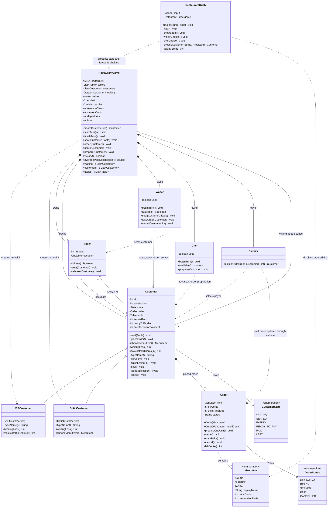

# Restaurant Rush Stage 2 - UML class diagram

This diagram extends the Stage 1 diagram with the implemented customer changes described in `stage_2_plan.md`. Visibility markers use UML notation: `+` public, `-` private, `#` protected.

## Design notes

- **Encapsulation:** domain state is private; game operations update it through methods.
- **Composition:** `RestaurantGame` owns its staff and tables; each `Customer` owns at most one `Order`.
- **Responsibility split:** `RestaurantRush` handles console input/output, `RestaurantGame` advances the rules, staff classes enforce work limits, and `Customer`, `Order`, and `Table` own their state transitions.
- **Polymorphism:** `Customer` retains Regular defaults (loss 8, full price, ID-based dish cycle). `VIPCustomer` overrides loss to 5 and billing to 90% of full price. `CriticCustomer` overrides loss to 12 and always chooses Pasta. Shared lifecycle methods call these overrides through `Customer` references.
- **Encapsulation:** `Order` stores a private final bill fixed at ordering. `Customer.placeOrder()` selects the item, calls `calculateBillCents()`, and creates the order; the cashier path uses the stored amount.
- **Stage 1 continuity:** the existing classes, associations, staff responsibilities, and turn flow are preserved. Only arrival registration, customer behaviour, order billing, and CLI labels change. The queue relationship is a subset of tracked customers, not separate ownership. `CustomerState` and `OrderStatus` label the nested enums `Customer.State` and `Order.Status`.

