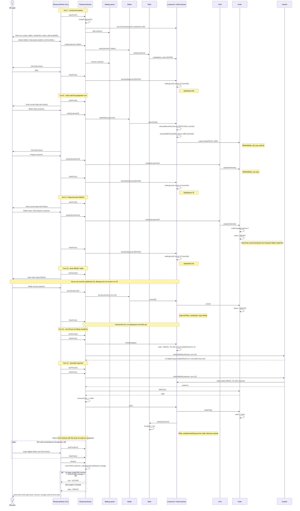

# Restaurant Rush Stage 2 - UML sequence diagram

This diagram extends the Stage 1 sequence directly. The scenario follows Critic customer #3, whose overridden preference always chooses Pasta. The customer arrives on turn 7, is served on turn 10, and pays on turn 12. A final victory check happens only after all 18 turns.

## Stage 2 changes from the Stage 1 sequence

- The same arrival-to-payment Pasta scenario and participants are retained. Customer #3 is now a Critic, created by the fixed arrival setup.
- The Critic chooses Pasta polymorphically and loses 12 satisfaction per unserved turn: 88, 76, then 64. All service and payment turns remain unchanged.
- Serving on turn 10 rather than turn 11 changes this customer's recorded satisfaction from 52 to 64. With the other victory-plan actions unchanged, delaying service alone would change the final average from 78.5 to 75.5; both still win. This illustrates an outcome change without claiming a different ending.
- The bill is locked when ordering and remains full price for the Critic. VIP #2 in the surrounding victory run pays $13.50 for Burger through its billing override.
- Following the complete Stage 2 victory plan yields four paid customers, $49.50 revenue, average satisfaction 78.5, and 18 turns. 
